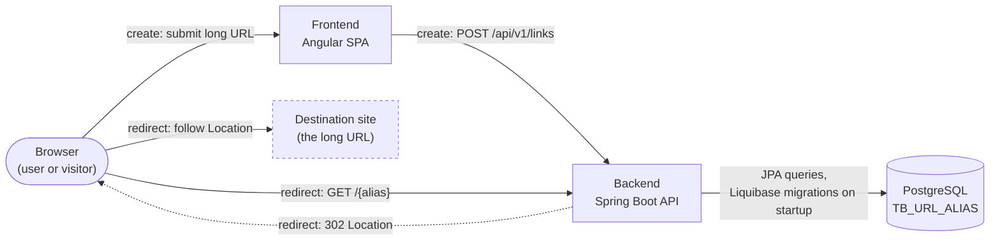
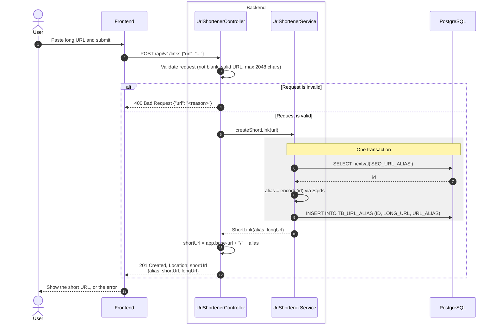
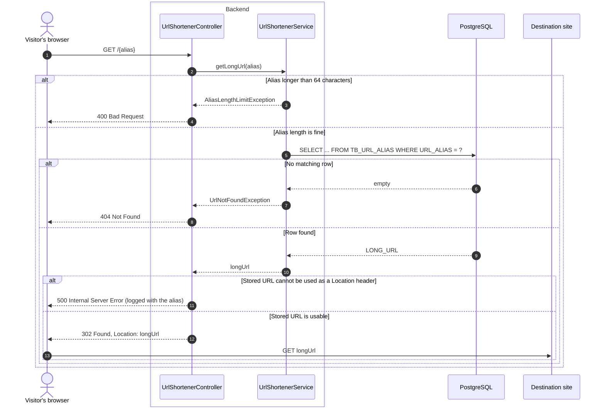

# URL Shortener — Backend

A Spring Boot service that turns a long URL into a short code, and redirects
visitors from that code back to the original URL.

The scope is deliberately small. The emphasis is on building in independently
testable increments, and on recording *why* each decision was made — the
reasoning lives in [`docs/`](./docs), not just in the commit history.

---

## Architecture

The diagrams below cover v1 only.

### System overview



There are three components: an Angular frontend, this Spring Boot backend, and a
single PostgreSQL table. The two v1 flows take different routes. **Creating** a
link goes through the frontend, which calls the JSON API. **Following** a short
link skips the frontend entirely: the short URL points at the backend's
root-level `/{alias}`, so the visitor's browser asks the backend directly and is
sent on to the destination with a `302`. Liquibase applies the schema when the
backend starts; nothing else writes to the database's structure.

### Creating a short link



The controller validates the request body before any work is done, so a bad URL
never reaches the database. For a valid URL, the service takes the next id from
the `SEQ_URL_ALIAS` sequence, encodes it into a non-sequential alias with Sqids,
and writes the id, long URL and alias in a single `INSERT`. The id is known
before the row exists, which is why the alias can be stored in the same write
(see D10 in [`docs/DECISIONS.md`](./docs/DECISIONS.md)). The controller then
builds `shortUrl` from the configured `app.base-url` rather than from the
incoming request.

### Following a short link



A redirect is one indexed lookup on the unique `URL_ALIAS` column. An alias
longer than the column could ever hold is rejected with a `400` before the
database is queried, and an alias with no matching row gets a `404`. If a stored
URL somehow cannot be turned into a valid `Location` header, the backend returns
a `500` and logs the alias rather than sending the visitor somewhere broken. The
redirect is a `302`, not a `301`, so browsers don't cache it (see D2 in
[`docs/DECISIONS.md`](./docs/DECISIONS.md)). Errors are turned into JSON
responses by `GlobalExceptionHandler`.

---

## Status

**v1 is in progress.** Both endpoints are built and covered by tests, including
an end-to-end test that creates a link and follows it against a real Postgres.
What remains is making the error responses consistent.

| Area | State |
|------|-------|
| Project skeleton, dependencies, container setup | Done |
| Liquibase migration for `TB_URL_ALIAS`, verified by an integration test | Done |
| `UrlAlias` entity + repository, covered by Testcontainers tests | Done |
| Request validation (`@NotBlank`, `@Size(2048)`, `@URL`) + `GlobalExceptionHandler` | Done |
| `POST /api/v1/links` — create a short link | Done |
| `GET /{alias}` — redirect, with `404` / `400` / `500` error cases | Done |
| One consistent JSON shape for all error responses | Next |

Current progress and the next planned increment are tracked in
[`docs/ROADMAP.md`](./docs/ROADMAP.md).

---

## Tech stack

- **Java 21**
- **Spring Boot 4.1** — Web MVC, Data JPA, Validation
- **PostgreSQL 18**
- **Liquibase** for schema migrations, applied at application startup
- **Testcontainers** + JUnit 5 for integration tests against a real Postgres
- **Maven** via the wrapper (`./mvnw`, pinned to 3.9.11)

---

## Getting started

### Prerequisites

- **JDK 21.**
- **A running container runtime** — Docker Desktop, OrbStack, Colima or Podman.
  Both Testcontainers and Docker Compose need a live daemon; check with `docker info`.
- Maven is *not* required — `./mvnw` downloads its own pinned version on first use.
- [direnv](https://direnv.net) is optional, and only convenient for running the
  app or `psql` against the local database.

### Clone

```bash
git clone git@github.com:azharrohiman/url-shortener-be.git
cd url-shortener-be
```

### Run the tests

```bash
./mvnw test
```

This needs **no configuration and no `.env`**. Integration tests start a
throwaway Postgres via Testcontainers with generated credentials, boot the
Spring context against it, and let Liquibase apply the migrations. A fresh
clone with a JDK and a container runtime can run the full suite immediately.

### Run the application

Database credentials are not committed. Copy the template first:

```bash
cp .env.example .env    # edit the values if you want
direnv allow            # one-off, if you use direnv
./mvnw spring-boot:run
```

`spring-boot:run` uses the Spring Boot Docker Compose integration to start the
Postgres defined in `compose.yaml` automatically. The API listens on
`http://localhost:8080`.

To run against a throwaway database instead, with no `.env` required:

```bash
./mvnw spring-boot:test-run
```

### Run the whole stack in containers

For anyone who wants a running backend without a JDK or an IDE — a frontend
developer, for instance:

```bash
cp .env.example .env    # compose refuses to start without it
docker compose -f compose.app.yaml up --build
```

This starts Postgres and the backend together, applies the migrations on boot,
and serves the API on `http://localhost:8080`.

---

## API

The agreed contract, in full, is in [`docs/DESIGN.md`](./docs/DESIGN.md).
Summarised:

| Method | Path              | Success | Errors |
|--------|-------------------|---------|--------|
| `POST` | `/api/v1/links`   | `201` with the alias and short URL | `400` invalid URL |
| `GET`  | `/{alias}`        | `302` to the long URL | `400` alias too long, `404` unknown alias, `500` stored URL unusable |

Two namespaces are kept separate on purpose: `/api/v1/...` for the JSON
management API, and a root-level `/{alias}` so short URLs stay short.

---

## Documentation

| Document | Contents |
|----------|----------|
| [`docs/ROADMAP.md`](./docs/ROADMAP.md) | Scope, features, build order, and what is done vs. next |
| [`docs/DESIGN.md`](./docs/DESIGN.md) | API contract, data model, naming conventions |
| [`docs/DECISIONS.md`](./docs/DECISIONS.md) | Append-only log of technical decisions, trade-offs, and open risks |
| [`docs/WORKFLOW.md`](./docs/WORKFLOW.md) | How to develop, test, and run the project locally |

New to the codebase? Read `ROADMAP.md` for the shape of the project, then
`WORKFLOW.md` before running anything.

---

## Contributing

`main` is protected — all changes go through a pull request, squash-merged,
with signed commits. Branch naming, pull request conventions, and the full
workflow are documented in [CONTRIBUTING.md](./CONTRIBUTING.md).

After cloning, enable the repository's Git hooks:

```bash
git config core.hooksPath .githooks
```

---

## Licence

[MIT](./LICENSE)
