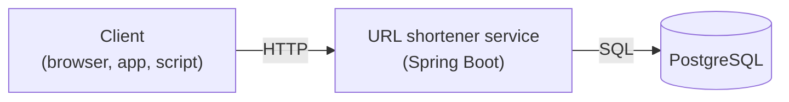
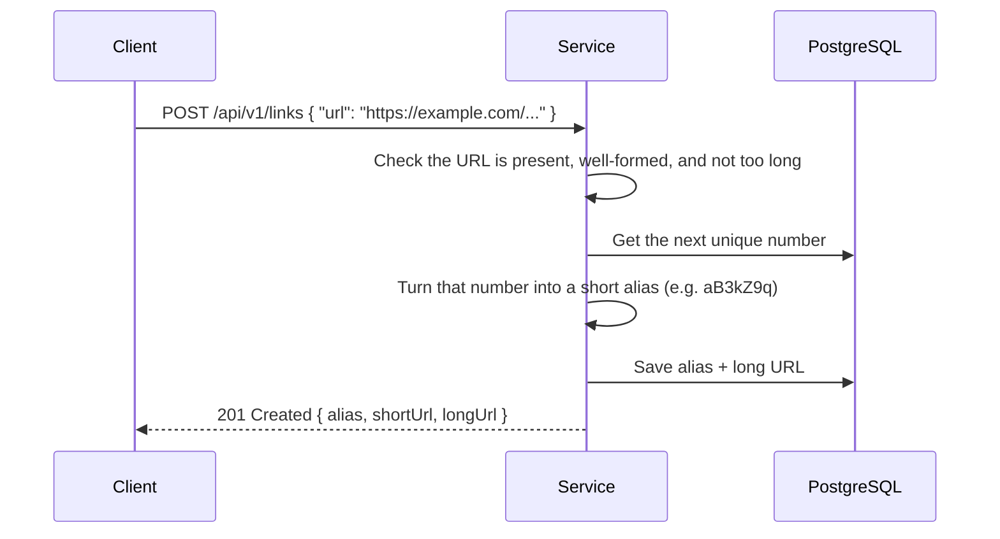
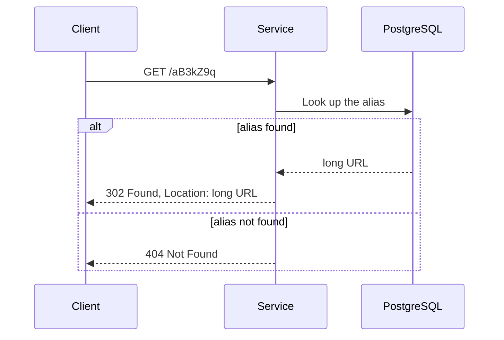

# High-Level Design

> The big picture: what the parts of the system are, how a request moves through them, and the
> API the outside world sees. For the table layout, code layers and log fields, see
> [DESIGN_DEEP_DIVE.md](./DESIGN_DEEP_DIVE.md). For the scale this design is sized against, see
> [BACK_OF_THE_ENVELOPE_ESTIMATION.md](./BACK_OF_THE_ENVELOPE_ESTIMATION.md).

_Last updated: 2026-11-10_

---

## What the system does

It does two things:

1. **Shorten.** Someone sends a long URL and gets back a short one, e.g.
   `https://example.com/some/very/long/path` → `http://localhost:8080/aB3kZ9q`.
2. **Redirect.** Anyone who opens the short URL is sent on to the original long URL.

## Components



| Component | Role |
|-----------|------|
| **Client** | Anything that speaks HTTP. Creates links through the API, or follows a short URL. |
| **URL shortener service** | A single, stateless application. Checks input, creates aliases, and answers redirects. "Stateless" means it keeps nothing in memory between requests, so any copy of it can answer any request. |
| **PostgreSQL** | The one source of truth. Stores each alias next to its long URL. Its schema is managed by migrations that run when the service starts. |

## How a request flows

### Creating a short link



Every alias comes from a number the database hands out exactly once, so two links can never be
given the same alias.

### Following a short link



Redirects are the busy path: the estimate expects about 15 of them for every link created. That
makes this path the first one to measure, and the first place a cache would help.

---

## API contract (MVP)

Three namespaces, deliberately separate so they never collide:
- **`/api/v1/...`** — the JSON management API.
- **`/{alias}`** — root-level redirect, kept short so short URLs stay short.
- **`/actuator/health`** — the health check (see 3. below). Two path segments, so it can never
  be mistaken for an alias.

### 1. Create a short link

```
POST /api/v1/links
Content-Type: application/json

{ "url": "https://example.com/some/very/long/path" }
```

**201 Created**, with `Location: <shortUrl>`. `shortUrl` is built from the `app.base-url`
property, not from the incoming request.
```json
{
  "alias":    "aB3kZ9q",
  "shortUrl": "http://localhost:8080/aB3kZ9q",
  "longUrl":  "https://example.com/some/very/long/path"
}
```

**400 Bad Request** — missing/blank URL, malformed URL, or longer than 2048 chars. Every failed
check is listed, so one field can appear more than once:
```json
{
  "status":  400,
  "title":   "The payload is invalid",
  "detail":  "The payload has one or more validation errors, please fix them and try again.",
  "validation": [
    { "field": "url", "message": "URL is not valid." },
    { "field": "url", "message": "URL must not exceed 2048 characters." }
  ]
}
```

### 2. Redirect

```
GET /{alias}
```

**302 Found** with `Location: <longUrl>` when the alias exists. No body.

**400 Bad Request** — the alias is longer than 64 characters, the width of `URL_ALIAS`. Rejected
before the database is queried, since no stored alias can match it:
```json
{
  "status":  400,
  "title":   "Alias too long",
  "detail":  "Alias length 65 exceeds limit of 64."
}
```

**404 Not Found** — no row has this alias. Aliases are case-sensitive:
```json
{
  "status":  404,
  "title":   "URL not found",
  "detail":  "No URL found with alias: aB3kZ9q"
}
```

**500 Internal Server Error** — a row exists, but its `LONG_URL` can't be turned into a valid
`Location` header. That is a fault on our side, not the caller's, so it is logged with the alias.
The body is fixed and doesn't echo the stored URL:
```json
{
  "status":  500,
  "title":   "Broken link",
  "detail":  "This link is broken on our side. Let the person who shared it know."
}
```

302 (not 301) is intentional — see [DECISIONS.md](../DECISIONS.md#d2--redirect-with-http-302-not-301) D2.

### 3. Health check

```
GET /actuator/health
```

Provided by Spring Boot Actuator, not by our own controller. Answers one question: is the app
running **and** able to reach the database? Meant for whatever needs to know the app is ready —
a load-test script before it starts, or a hosting platform before it sends traffic.

**200 OK** — every check passed, including the database check:
```json
{
  "status": "UP",
  "groups": ["liveness", "readiness"]
}
```

**503 Service Unavailable** — at least one check failed (for example, Postgres can't be reached).
Same shape, with `"status": "DOWN"`.

- **Details are hidden on purpose.** The endpoint is public and anonymous, so the body never says
  *which* checks ran or why one failed — no database product, no disk space, no error messages.
  This is Spring Boot's default (`show-details: never`); keep it.
- **`groups`** lists the names of two extra checks Spring Boot 4 adds by default:
  `liveness` ("is the app running?") and `readiness` ("is it ready to take traffic?"), served at
  `/actuator/health/liveness` and `/actuator/health/readiness`. Hosting platforms use these at
  deployment time. Only their names appear here, not their contents.
- **Not an RFC 9457 error.** A `DOWN` response uses Actuator's own shape and content type, not the
  problem+json body described below. It is a status report, not an error in a request.
- **Only `health` is exposed** over HTTP — Spring Boot's default. Actuator's index page at
  `/actuator` is turned off (`management.endpoints.web.discovery.enabled: false`): it is a single
  path segment, so it would take that path away from `/{alias}`. `GET /actuator` is therefore an
  ordinary alias lookup, and returns the redirect's 404.

### Error responses

Every error from the create and redirect endpoints returns one body shape based on RFC 9457 ("Problem Details for
HTTP APIs"). `status`, `title` and `detail` are standard RFC members; `validation` is an extension
member, which the RFC allows:

| Field        | Type   | Always present? | Meaning |
|--------------|--------|-----------------|---------|
| `status`     | number | yes | The HTTP status code, repeated in the body (`400`, `404`, `500`). |
| `title`      | string | yes | Short summary of the kind of error. Fixed per error type, so it never varies between two occurrences of the same error. |
| `detail`     | string | yes | What caused this occurrence and, where the caller can act on it, how to fix it. |
| `validation` | array  | only on request-validation failures | One entry `{ "field", "message" }` per failed check. Omitted, not empty, on every other error. |

- Error bodies are sent with `Content-Type: application/problem+json`, the media type RFC 9457
  defines, so clients can tell an error body from a success body without parsing it.
- `validation` lists **every** failed check, so the same `field` can appear more than once.
  Entry order is not guaranteed; clients and tests must not rely on it.
- 500 bodies never carry internal detail (stack traces, stored values). The cause goes to the
  log, not the response.
